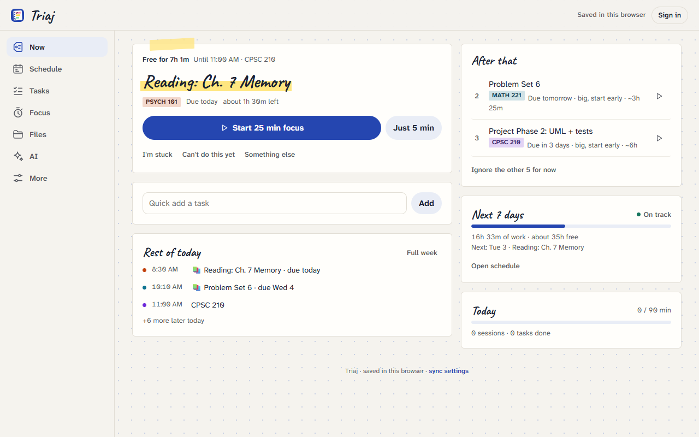
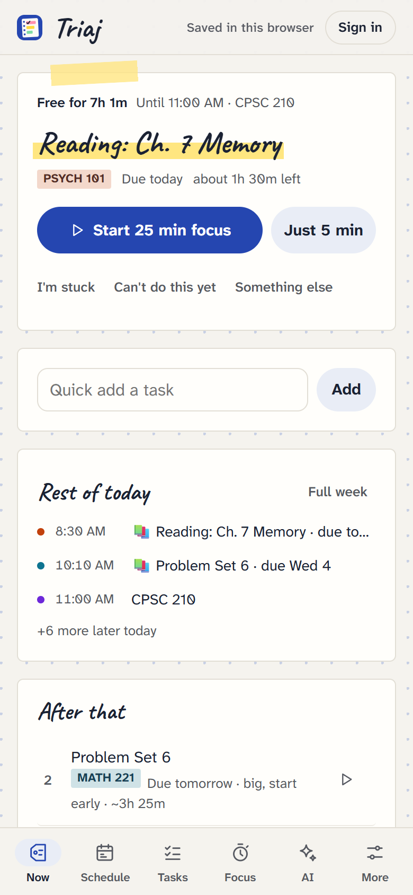

<p align="center"></p>
<h1 align="center">Triaj</h1>
<p align="center"><b>Your semester, triaged.</b><br>A student planner that pulls everything in from Canvas, plans your study time around your classes, and keeps you focused, on any device.</p>
<p align="center"><a href="https://skrunklevevo.github.io/triaj/"><b>Website</b></a> · <a href="https://skrunklevevo.github.io/triaj/app/"><b>Open the app</b></a> · <a href="https://skrunklevevo.github.io/triaj/#companion">Install the companion</a></p>

<p align="center">&nbsp;</p>

## What it does

- **Canvas sync.** Assignments, quizzes (even locked ones), discussions, peer reviews, to-do notes and exam dates. New items arrive on their own, changed due dates update (or ask, if you edited the date yourself), and submitted work gets checked off.
- **A plan that builds itself.** Class times, routines and how fast you work turn into study blocks that fit the gaps in your week, work ahead of deadlines, and surface the one thing to do next.
- **Focus timer.** Pomodoro, deep work, sprint and custom presets, refocus nudges, synthesized sounds and brown/pink/white noise, and focus minutes logged per task. With the companion it runs in the extension: a countdown on the toolbar icon, notifications with Pause/Skip buttons, Alt+Shift+F anywhere, and it keeps going with Triaj closed.
- **Site blocking during focus.** List the sites that pull you away; while a focus round runs the companion swaps them for a "back to focus" page with your timer (5-minute passes allowed). Breaks are free.
- **AI that suggests, you decide.** Weekly planning, tasks from a sentence, exam dates from syllabus PDFs, "I'm stuck" first steps. Bring your own key (free with Gemini, or Claude). Nothing changes until you press Apply.
- **Everywhere.** Sign in with Google or email and the planner syncs live between every browser and device. Installable as an app on phones (PWA) and usable offline.
- Also: prerequisites and "can't do this yet", in-class tests, iCal feeds, course-file downloads into tidy folders, budget, a paper-notebook look with 8 pen colors × light/dark/black (all WCAG AA) and dotted, ruled, grid or blank paper, backups and one-click undo, and an "Export for AI" plain-text dump.

## How it's built

```
web/                     GitHub Pages site (no build step, plain ES modules)
  index.html             landing page
  manifest.webmanifest   installable app (whole site)
  sw.js                  offline cache + notification actions
  app/                   the app
    boot.js              account → local data → planner + engine
    app.js               planner UI
    lib/morph.js         re-renders Now, Focus and Files in place, so transitions run and focus survives
    lib/platform.js      storage (IndexedDB, shared across tabs), alarms, notifications, permissions
    lib/cloud.js         Firebase Auth + Firestore sync
    lib/engine.js        timer, Canvas/calendar sync schedule, digests, backups
    lib/bridge.js        talks to the companion extension
    lib/shared.js        data model, scheduling helpers, iCal parsing, sync merge, themes
    lib/canvas-scan.js   reads Canvas (also copied into the extension)
    lib/timer-core.js    the focus timer (also copied into the extension)
    lib/install.js       install prompt / Add to Home Screen steps
extension/               Triaj Companion (Manifest V3, Chrome/Edge/Brave/Opera/Firefox)
firestore.rules          each account reads/writes only users/{uid}/…
```

**Why a companion extension?** Browsers don't let a website read another site with your cookies, Canvas doesn't allow cross-origin API calls, and only an extension can block sites or put a timer on the toolbar. So the website does the planning, and the extension handles what it can't: fetching from sites you explicitly allow (Canvas, private iCal feeds), the background focus timer and toolbar popup, site blocking (declarativeNetRequest), saving files to Downloads, and "Sync from this tab". The timer logic is one module (`timer-core.js`) shared by both, so it behaves the same with or without the extension. The page talks to it through a content script with `window.postMessage`; host access is optional and granted per site.

**Sync design.** The plan is stored per account in IndexedDB and mirrored to Firestore as one document per top-level field (`tasks`, `classes`, `cfg`…), chunked under the 1 MiB limit, each with a content hash. Each browser remembers the hash it last agreed on with the server, so on every snapshot it can tell "I changed this" from "another device changed this" and only uploads what actually changed. Offline edits are kept locally and sent on reconnect.

**Multi-tab.** Tabs share state over `BroadcastChannel`; a Web Lock elects one tab to fire timers and scheduled syncs, so several open tabs never double up.

## Run it locally

```sh
cd web && python -m http.server 8765
# open http://localhost:8765/app/
```
Load `extension/` as an unpacked extension to use Canvas sync locally (it also runs on `localhost`). After changing `canvas-scan.js`, `timer-core.js` or `sounds.js` in `web/app/lib`, run `node scripts/sync-extension.mjs`.

Firebase project: `triaj-planner-21678`. Deploy rules and auth providers with `firebase deploy --only firestore:rules,auth`. The site deploys to GitHub Pages on every push to `main` (`.github/workflows/pages.yml`), which also packages `triaj-companion.zip`.

## Privacy

No ads, analytics or tracking. Your planner (and any Canvas token or AI key you add) lives in your own Firestore documents, readable only by your account. Canvas data goes from Canvas to your browser to your account. AI calls go straight from your browser to the provider you pick.

---
Made by [skrunkleVEVO](https://github.com/skrunkleVEVO). Triaj grew out of *My Planner*, a Chrome extension; backups from it restore straight into Triaj.
